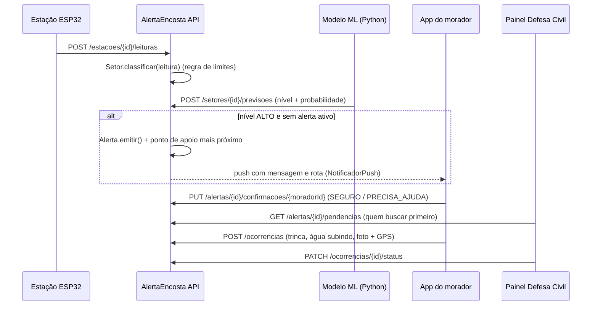
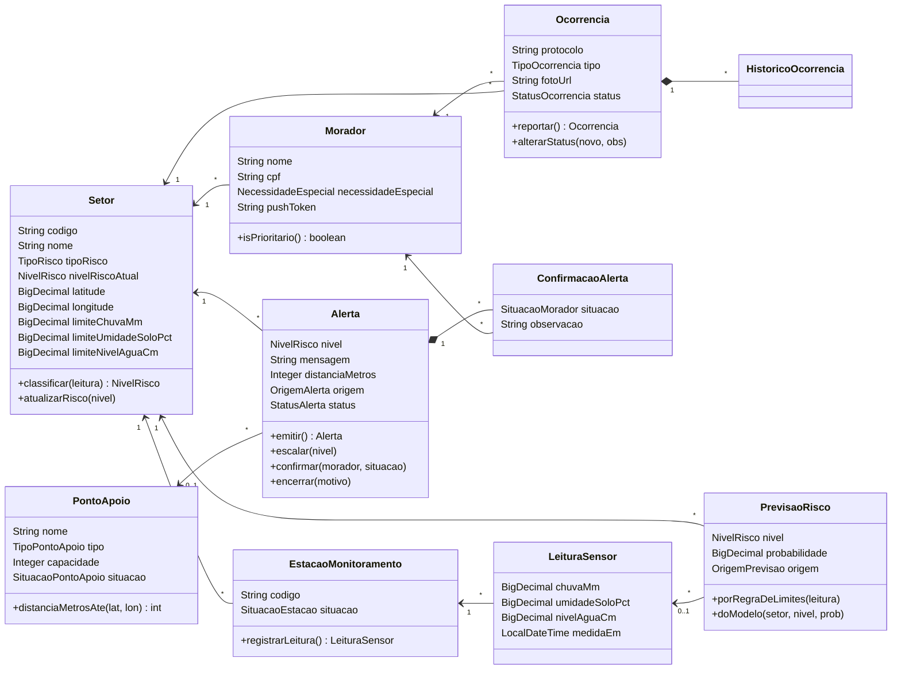
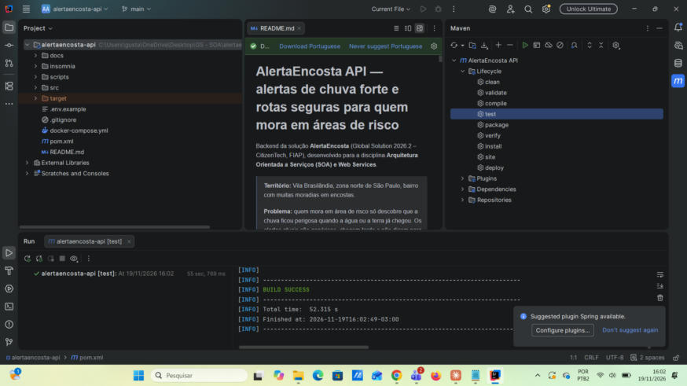
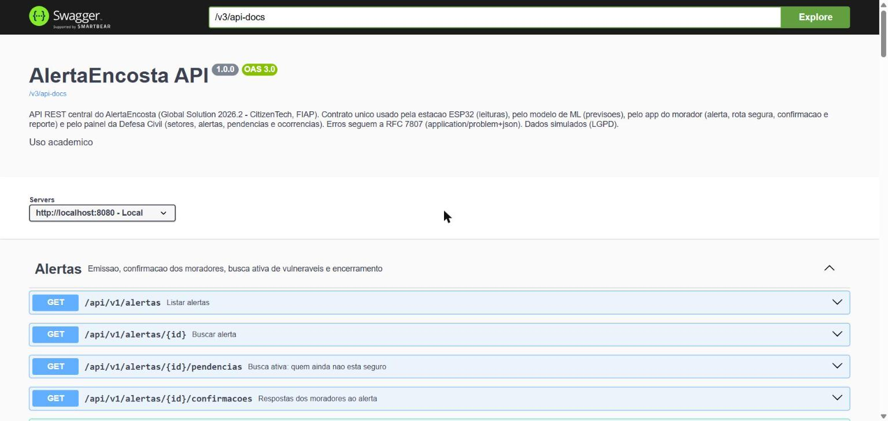
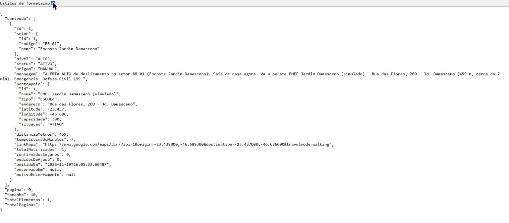
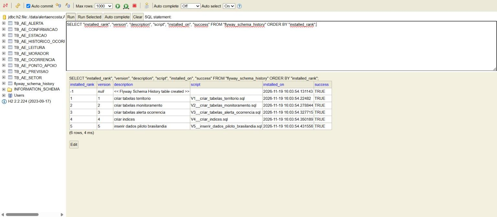

# AlertaEncosta API — alertas de chuva forte e rotas seguras para quem mora em áreas de risco

Backend da solução **AlertaEncosta** (Global Solution 2026.2 – CitizenTech, FIAP), desenvolvido para a disciplina **Arquitetura Orientada a Serviços (SOA) e Web Services**.

> **Território:** Vila Brasilândia, zona norte de São Paulo, bairro com muitas moradias em encostas.
>
> **Problema:** quem mora em área de risco só descobre que a chuva ficou perigosa quando a água ou a terra já chegou. Os alertas atuais são genéricos, chegam tarde e não dizem para onde ir.
>
> **O que esta API faz:** é o componente central da arquitetura (camada de Aplicação). Ela recebe as leituras das **estações ESP32** instaladas nas encostas e classifica o risco de cada **setor**, combinando a regra de limites com as previsões do **modelo de ML**. Quando o risco fica ALTO, emite automaticamente um **alerta com a rota a pé até o ponto de apoio mais próximo**. Também registra a resposta do morador ("estou seguro" / "preciso de ajuda"), prioriza **idosos e pessoas com deficiência** na busca ativa e recebe os **reportes de trincas e água subindo** para a Defesa Civil.

## Integrantes

| Nome | RM |
|---|---|
| Gustavo Neri Santos | RM560239 |
| Matheus Aparecido Rocha Plati | RM559813 |
| Gustavo Pandolfo Meroni | RM560271 |
| Gabriel Machado Belardino | RM550121 |
| Gustavo Franco Tárano | RM559616 |

---

## Sumário

1. [Papel da API na arquitetura AlertaEncosta](#papel-da-api-na-arquitetura-alertaencosta)
2. [Tecnologias](#tecnologias)
3. [Organização do código](#organização-do-código)
4. [Estruturação do domínio](#estruturação-do-domínio)
5. [Banco de dados e conexão](#banco-de-dados-e-conexão)
6. [Migrações (Flyway)](#migrações-flyway)
7. [Como executar](#como-executar)
8. [Endpoints](#endpoints)
9. [Testes manuais com Insomnia](#testes-manuais-com-insomnia)
10. [Evidências](#evidências)
11. [Mapeamento para os critérios de avaliação](#mapeamento-para-os-critérios-de-avaliação)

---

## Papel da API na arquitetura AlertaEncosta

A proposta (documento TOGAF/ArchiMate da equipe) define a **API REST como contrato único** entre todos os componentes. Cada disciplina consome esta API assim:

| Componente (disciplina) | Como usa a API |
|---|---|
| Estação ESP32 (Physical Computing) | `POST /estacoes/{id}/leituras` com chuva (mm), umidade do solo (%) e nível da água (cm) |
| Modelo de previsão (IA/ML, Python) | Lê `GET /estacoes/{id}/leituras` e publica `POST /setores/{id}/previsoes` |
| App do morador (Mobile, React Native) | Cadastro, `GET /moradores/{id}/rota-segura`, `PUT /alertas/{id}/confirmacoes/{moradorId}`, `POST /ocorrencias` |
| Painel da Defesa Civil (C#) | `GET /setores?nivel=ALTO`, `GET /setores/{id}/situacao`, `GET /alertas/{id}/pendencias`, `PATCH /ocorrencias/{id}/status`, `GET /indicadores` |
| Expo Push (Tecnologia) | Isolado atrás da interface `NotificadorPush`; no protótipo, `NotificadorPushSimulado` registra os envios no log |

Fluxo principal: *chuva forte → leitura → limite atingido → alerta com rota → morador confirma ou pede ajuda*.



## Tecnologias

| Camada | Tecnologia |
|---|---|
| Linguagem | Java 21 |
| Framework | Spring Boot 3.3 (Web, Validation, Data JPA) |
| Persistência | JPA / Hibernate 6. Todas as consultas usam *prepared statements*, como pede a disciplina de Cybersecurity contra SQL Injection |
| Banco de dados | **Oracle** (perfil `oracle`: FIAP ou Docker) e **H2** (perfil `dev`, roda sem instalar nada) |
| Migrações | **Flyway**, com scripts versionados por banco |
| Documentação | OpenAPI 3 + Swagger UI (springdoc) |
| Erros | RFC 7807 — Problem Details |
| Testes | Insomnia (manuais) + JUnit 5 / MockMvc (automatizados) |

## Organização do código

```
src/main/java/br/com/fiap/alertaencosta
├── domain
│   ├── model        → 10 entidades + 12 enums + Geo (Haversine). As REGRAS DE NEGÓCIO ficam aqui
│   └── exception    → exceções de domínio (404 / 409 / 422)
├── repository       → Spring Data JPA, Specifications e consultas agregadas
├── service          → casos de uso e transações; MonitoramentoService orquestra leitura → risco → alerta
│                      NotificadorPush (interface) + NotificadorPushSimulado
├── web
│   ├── controller   → 7 controllers REST (/api/v1/...)
│   ├── dto          → contratos de entrada/saída (records) com Bean Validation e exemplos OpenAPI
│   └── handler      → tratamento global de erros (RFC 7807)
└── config           → metadados OpenAPI
src/main/resources/db/migration/{h2,oracle}/V1..V5   → migrações Flyway
```

Princípios de SOA e REST aplicados:
- **Contrato explícito:** a API expõe DTOs e nunca as entidades JPA. O CPF volta mascarado e o token push nunca é devolvido (LGPD: só o necessário).
- **Recursos e verbos HTTP (nível 2 de Richardson):**
  - `PUT /alertas/{id}/confirmacoes/{moradorId}` é **idempotente**: o morador pode reenviar a resposta sem duplicá-la.
  - `PATCH` faz alterações parciais (status, encerramento).
  - `POST` cria e retorna `201` com `Location`; `DELETE` retorna `204`.
- **Status codes corretos:** 200, 201, 204, 400, 404, 409, 415, 422 e 500, sempre no formato Problem Details.
- **Baixo acoplamento com serviços externos:** o envio de push depende só da interface `NotificadorPush`.
- **Versionamento na URI** (`/api/v1`), API **stateless** e documentação viva no Swagger (code-first).

## Estruturação do domínio



Mapeamento para os *Business Objects* e *Data Objects* da proposta:

| Objeto na proposta | Entidade |
|---|---|
| Cadastro do morador | `Morador` |
| Setor de risco | `Setor` |
| Ponto de apoio | `PontoApoio` |
| Leitura de sensor | `EstacaoMonitoramento` + `LeituraSensor` |
| Previsão de risco | `PrevisaoRisco` |
| Alerta | `Alerta` + `ConfirmacaoAlerta` |
| Ocorrência | `Ocorrencia` + `HistoricoOcorrencia` |

### Regras de negócio (implementadas nas entidades)

| Regra | Onde | Resposta |
|---|---|---|
| **Regra de limites:** o risco é ALTO se chuva, umidade do solo ou nível da água atinge 100% do limite do setor, **ou** se chuva e solo estão ambos ≥ 85% (solo saturado). É MÉDIO acima de 70%; abaixo disso, BAIXO | `Setor.classificar()` | — |
| O nível do setor é sempre o da classificação mais recente, seja da regra de limites ou do modelo de ML | `MonitoramentoService` | — |
| Risco ALTO **emite alerta automático**. Se já houver alerta MÉDIO ativo, ele é **escalado**; se já houver ALTO, nada é duplicado | `AlertaService.aplicarRisco()`, `Alerta.escalar()` | `acao` na resposta |
| No máximo **um alerta ATIVO por setor** | `AlertaService` | 409 |
| Alerta só para MÉDIO ou ALTO, e nunca indicando ponto de apoio INATIVO | `Alerta.emitir()` | 422 |
| A rota segura usa o ponto **ATIVO** mais próximo (Haversine), com tempo a pé a 70 m/min e link do Google Maps | `PontoApoio`, `Geo`, `RotaSeguraResponse` | — |
| A mensagem do alerta é montada pela API: nível, tipo de risco, setor, ponto de apoio, distância, tempo a pé e o telefone 199 | `Alerta.montarMensagem()` | — |
| Cada morador tem **uma** resposta por alerta, que pode ser atualizada (PUT idempotente). Só respondem moradores do setor do alerta, e só enquanto o alerta está ATIVO | `Alerta.confirmar()` | 422 |
| **Busca ativa:** primeiro quem pediu ajuda, depois idosos e PcD sem resposta, depois os demais | `AlertaService.pendencias()` | — |
| O encerramento do alerta exige motivo, e `ENCERRADO` é terminal | `Alerta.encerrar()` | 400 / 422 |
| A estação só envia leitura se estiver `ATIVA`. Medição com horário no futuro (relógio do ESP32 adiantado) é rejeitada | `EstacaoMonitoramento.registrarLeitura()` | 422 |
| A probabilidade do modelo fica entre 0 e 1 | `PrevisaoRisco.doModelo()` | 400 / 422 |
| Fluxo do reporte: `ABERTA → EM_VISTORIA → RESOLVIDA`, e `DESCARTADA` exige justificativa. Toda mudança fica no histórico | `Ocorrencia.alterarStatus()` | 422 |
| Só se exclui reporte `ABERTA`. Setor, morador, estação e ponto com histórico não são excluídos (estação e ponto viram `INATIVA`/`INATIVO`) | entidades e services | 409 / 422 |
| E-mail e CPF únicos. E-mail normalizado. CPF guardado só com dígitos e devolvido mascarado | `Morador`, `MoradorResponse` | 409 |

## Banco de dados e conexão

| Perfil | Banco | Uso |
|---|---|---|
| `dev` (padrão) | H2 em arquivo (`./data/alertaencosta`) | Rodar e avaliar sem instalar nada. Console em `/h2-console` |
| `oracle` | Oracle (FIAP `oracle.fiap.com.br` ou Docker) | Banco relacional da arquitetura |

- As credenciais do Oracle vêm **somente de variáveis de ambiente** (`DB_URL`, `DB_USERNAME`, `DB_PASSWORD`). Nenhuma senha fica no repositório.
- `ddl-auto=validate`: o Hibernate **não cria tabelas**, só confere se as entidades batem com o schema das migrações. Uma entidade alterada sem a migração correspondente impede a aplicação de subir.
- `open-in-view=false`: as transações ficam delimitadas nos services.

### Modelo físico (prefixo `TB_AE_`)

| Tabela | Conteúdo | Restrições principais |
|---|---|---|
| `TB_AE_SETOR` | Setores e limites | PK, `UK` código, `CHECK` tipo/nível/limites |
| `TB_AE_PONTO_APOIO` | Pontos de apoio | PK, `CHECK` tipo/situação/capacidade |
| `TB_AE_MORADOR` | Moradores | PK, `UK` e-mail, `UK` CPF, FK setor, `CHECK` necessidade |
| `TB_AE_ESTACAO` | Estações ESP32 | PK, `UK` código, FK setor, `CHECK` situação |
| `TB_AE_LEITURA` | Leituras | FK estação, `CHECK` faixas dos sensores |
| `TB_AE_PREVISAO` | Previsões | FKs setor/leitura, `CHECK` nível/origem/probabilidade |
| `TB_AE_ALERTA` | Alertas | FKs setor/ponto, `CHECK` nível (só MÉDIO/ALTO), status, encerramento |
| `TB_AE_CONFIRMACAO` | Respostas dos moradores | `UK` (alerta, morador), FKs |
| `TB_AE_OCORRENCIA` | Reportes | `UK` protocolo, FKs, `CHECK` tipo/status |
| `TB_AE_HISTORICO_OCORRENCIA` | Auditoria dos reportes | FK `ON DELETE CASCADE` |

## Migrações (Flyway)

Os scripts ficam em `src/main/resources/db/migration/{vendor}`. O Spring Boot resolve `{vendor}` para `h2` ou `oracle`, e cada banco recebe o SQL no próprio dialeto.

| Versão | Script | O que faz |
|---|---|---|
| V1 | `V1__criar_tabelas_territorio.sql` | Setor, ponto de apoio e morador |
| V2 | `V2__criar_tabelas_monitoramento.sql` | Estação, leitura e previsão |
| V3 | `V3__criar_tabelas_alerta_ocorrencia.sql` | Alerta, confirmação, ocorrência e histórico |
| V4 | `V4__criar_indices.sql` | 13 índices para o painel, o fluxo de leituras e as FKs |
| V5 | `V5__inserir_dados_piloto_brasilandia.sql` | Carga **simulada** do piloto (detalhes abaixo) |

O que a V5 carrega:
- 4 setores e 4 pontos de apoio (um deles inativo);
- 6 moradores, sendo 3 prioritários;
- 3 estações (uma em manutenção), com as leituras e previsões correspondentes;
- o setor **BR-02 em risco ALTO**, com alerta ativo: um morador seguro, uma moradora pedindo ajuda e uma sem resposta;
- 3 reportes em etapas diferentes do atendimento.

Boas práticas: migrações imutáveis (mudança = nova versão `V6__...`), constraints com nome explícito e carga sem IDs fixos (subconsultas por chave natural). Além disso, `baseline-on-migrate` com `baseline-version=0` permite usar um schema da FIAP que já tenha tabelas de outras disciplinas.

## Como executar

**Pré-requisitos:** JDK 21 e Maven 3.9+ (ou IntelliJ IDEA).

### H2 (padrão, sem instalar banco)

```bash
mvn spring-boot:run
```

- Swagger UI: http://localhost:8080/swagger-ui.html
- OpenAPI: http://localhost:8080/v3/api-docs
- Console H2: http://localhost:8080/h2-console (JDBC `jdbc:h2:file:./data/alertaencosta`, usuário `sa`, senha vazia)
- Para **resetar** o banco, pare a aplicação e apague a pasta `data/`.

### Oracle da FIAP

```bash
export DB_URL="jdbc:oracle:thin:@oracle.fiap.com.br:1521:ORCL"
export DB_USERNAME="RM560239"
export DB_PASSWORD="sua_senha"
mvn spring-boot:run -Dspring-boot.run.profiles=oracle
```

No Windows PowerShell, use `$env:DB_URL="..."` (e o mesmo para as outras variáveis) e `mvn spring-boot:run "-Dspring-boot.run.profiles=oracle"`. No IntelliJ: *Active profiles* = `oracle` e as três variáveis em *Environment variables*.

### Oracle em Docker

```bash
docker compose up -d
DB_URL=jdbc:oracle:thin:@localhost:1521/FREEPDB1 DB_USERNAME=alertaencosta DB_PASSWORD=alertaencosta \
  mvn spring-boot:run -Dspring-boot.run.profiles=oracle
```

### Testes automatizados

```bash
mvn test
```

Rodam dois conjuntos:
- **`DominioAlertaEncostaTest`:** regras de negócio sem banco, incluindo a classificação de risco parametrizada.
- **`AlertaEncostaApiIntegrationTest`:** sobe a aplicação com H2 em memória e valida as migrações, o `ddl-auto=validate` e o fluxo leitura → alerta → pendências.

## Endpoints

Base `http://localhost:8080/api/v1`. O contrato completo e interativo está no Swagger.

| Recurso | Método e URI | Sucesso | Erros |
|---|---|---|---|
| Setores | `POST /setores` | 201 | 400, 409 |
| | `GET /setores?nivel=ALTO` | 200 | |
| | `GET /setores/{id}` · `PUT /setores/{id}` · `DELETE /setores/{id}` | 200 · 200 · 204 | 404, 409 |
| | `GET /setores/{id}/situacao` | 200 | 404 |
| | `POST /setores/{id}/previsoes` (modelo de ML) | 201 | 400, 404 |
| | `GET /setores/{id}/previsoes` | 200 | 404 |
| Pontos de apoio | `POST /pontos-apoio` · `GET /pontos-apoio?situacao=` | 201 · 200 | 400 |
| | `GET /pontos-apoio/mais-proximo?latitude&longitude` | 200 | 400, 404 |
| | `GET` · `PUT` · `DELETE /pontos-apoio/{id}` | 200 · 200 · 204 | 404, 409 |
| Moradores | `POST /moradores` · `GET /moradores?setorId=` | 201 · 200 | 400, 404, 409 |
| | `GET` · `PUT` · `DELETE /moradores/{id}` | 200 · 200 · 204 | 404, 409 |
| | `GET /moradores/{id}/rota-segura` | 200 | 404 |
| Estações | `POST /estacoes` · `GET /estacoes?setorId=` | 201 · 200 | 400, 404, 409 |
| | `GET` · `PUT` · `DELETE /estacoes/{id}` | 200 · 200 · 204 | 404, 409 |
| | `POST /estacoes/{id}/leituras` (ESP32) | 201 | 400, 404, 422 |
| | `GET /estacoes/{id}/leituras` | 200 | 404 |
| Alertas | `POST /alertas` (manual) | 201 | 400, 404, 409, 422 |
| | `GET /alertas?status&setorId` · `GET /alertas/{id}` | 200 | 404 |
| | `PATCH /alertas/{id}/encerramento` | 200 | 400, 404, 422 |
| | `PUT /alertas/{id}/confirmacoes/{moradorId}` | 200 | 404, 422 |
| | `GET /alertas/{id}/confirmacoes` · `GET /alertas/{id}/pendencias` | 200 | 404 |
| Ocorrências | `POST /ocorrencias` · `GET /ocorrencias?status&tipo&setorId&moradorId` | 201 · 200 | 400, 404 |
| | `GET /ocorrencias/{id}` · `GET /ocorrencias/protocolo/{protocolo}` | 200 | 404 |
| | `PATCH /ocorrencias/{id}/status` · `GET /ocorrencias/{id}/historico` | 200 | 404, 422 |
| | `DELETE /ocorrencias/{id}` | 204 | 404, 422 |
| Indicadores | `GET /indicadores` | 200 | |

Exemplo — a estação envia uma leitura acima do limite:

```http
POST /api/v1/estacoes/4/leituras
Content-Type: application/json

{ "chuvaMm": 75.5, "umidadeSoloPct": 92.0 }
```

```json
{
  "leitura": { "id": 7, "estacaoCodigo": "ESP32-BRA-05", "chuvaMm": 75.5, "umidadeSoloPct": 92.0, "...": "..." },
  "previsao": { "nivel": "ALTO", "origem": "REGRA_LIMITES", "...": "..." },
  "nivelAnterior": "BAIXO",
  "nivelAtual": "ALTO",
  "alerta": { "id": 2, "nivel": "ALTO", "status": "ATIVO", "totalNotificados": 1 },
  "acao": "ALERTA_EMITIDO"
}
```

Mensagem gerada no alerta: *"ALERTA ALTO de deslizamento no setor BR-05 (Viela da Paz e Escadaria). Saia de casa agora. Va a pe ate EE Viela da Paz (simulado) - Rua da Paz, 100 (...) Emergencia: Defesa Civil 199."*

## Testes manuais com Insomnia

A coleção está em [`insomnia/alertaencosta-insomnia.json`](insomnia/alertaencosta-insomnia.json): **70 requisições** em 8 pastas, com o caminho feliz **e** todos os erros (400, 404, 409, 422).

1. Insomnia → **Import** → selecione `insomnia/alertaencosta-insomnia.json`.
2. Suba a API com o banco limpo (apague `data/` antes).
3. Execute as requisições **na ordem**. O nome de cada uma indica o status esperado.
4. As variáveis ficam no *Base Environment*. Os valores (`setor_id`=5, `ponto_id`=5, `morador_id`=7, `estacao_id`=4, `alerta_id`=2, `ocorrencia_id`=4, `ponto_temp_id`=6) são os IDs gerados num banco recém-criado.

| # | Pasta | Requisicao | Esperado |
|---|---|---|---|
| 01 | Setores de risco | `POST /setores` Cadastrar setor | 201 |
| 02 | Setores de risco | `POST /setores` Cadastrar setor com codigo duplicado | 409 |
| 03 | Setores de risco | `POST /setores` Cadastrar setor invalido | 400 |
| 04 | Setores de risco | `GET /setores?nivel=ALTO` Listar setores em risco ALTO | 200 |
| 05 | Setores de risco | `GET /setores/{setor_id}` Buscar setor | 200 |
| 06 | Setores de risco | `GET /setores/2/situacao` Situacao do BR-02 (painel) | 200 |
| 07 | Setores de risco | `PUT /setores/{setor_id}` Atualizar setor (PUT) | 200 |
| 08 | Setores de risco | `DELETE /setores/2` Excluir setor em uso | 409 |
| 09 | Pontos de apoio e rota segura | `POST /pontos-apoio` Cadastrar ponto de apoio | 201 |
| 10 | Pontos de apoio e rota segura | `POST /pontos-apoio` Cadastrar ponto invalido | 400 |
| 11 | Pontos de apoio e rota segura | `GET /pontos-apoio?situacao=ATIVO` Listar pontos ATIVO | 200 |
| 12 | Pontos de apoio e rota segura | `GET /pontos-apoio/mais-proximo?latitude=-23.4525&longitude=-46.6950` Rota segura a partir do GPS | 200 |
| 13 | Pontos de apoio e rota segura | `GET /pontos-apoio/mais-proximo?latitude=-23.4525` Rota segura sem longitude | 400 |
| 14 | Pontos de apoio e rota segura | `PUT /pontos-apoio/{ponto_id}` Atualizar ponto (PUT) | 200 |
| 15 | Pontos de apoio e rota segura | `DELETE /pontos-apoio/2` Excluir ponto ja usado em alerta | 409 |
| 16 | Moradores | `POST /moradores` Cadastrar moradora idosa | 201 |
| 17 | Moradores | `POST /moradores` Cadastrar morador com e-mail duplicado | 409 |
| 18 | Moradores | `POST /moradores` Cadastrar morador invalido | 400 |
| 19 | Moradores | `POST /moradores` Cadastrar morador em setor inexistente | 404 |
| 20 | Moradores | `GET /moradores?setorId=2` Listar moradores do BR-02 | 200 |
| 21 | Moradores | `GET /moradores/{morador_id}` Buscar morador | 200 |
| 22 | Moradores | `GET /moradores/{morador_id}/rota-segura` Rota segura do morador | 200 |
| 23 | Moradores | `PUT /moradores/{morador_id}` Atualizar morador (PUT) | 200 |
| 24 | Moradores | `GET /moradores/9999` Buscar morador inexistente | 404 |
| 25 | Moradores | `DELETE /moradores/1` Excluir morador com historico | 409 |
| 26 | Estacoes ESP32 e leituras | `POST /estacoes` Cadastrar estacao | 201 |
| 27 | Estacoes ESP32 e leituras | `POST /estacoes` Cadastrar estacao duplicada | 409 |
| 28 | Estacoes ESP32 e leituras | `GET /estacoes?setorId=2` Listar estacoes do BR-02 | 200 |
| 29 | Estacoes ESP32 e leituras | `POST /estacoes/{estacao_id}/leituras` Leitura normal (chuva fraca) | 201 |
| 30 | Estacoes ESP32 e leituras | `POST /estacoes/{estacao_id}/leituras` Leitura acima do limite -> alerta automatico | 201 |
| 31 | Estacoes ESP32 e leituras | `POST /estacoes/{estacao_id}/leituras` Nova leitura forte com alerta ja ativo | 201 |
| 32 | Estacoes ESP32 e leituras | `GET /setores/{setor_id}/situacao` Situacao do novo setor | 200 |
| 33 | Estacoes ESP32 e leituras | `GET /estacoes/{estacao_id}/leituras` Historico de leituras da estacao | 200 |
| 34 | Estacoes ESP32 e leituras | `POST /estacoes/3/leituras` Leitura de estacao em MANUTENCAO | 422 |
| 35 | Estacoes ESP32 e leituras | `POST /estacoes/{estacao_id}/leituras` Leitura fora da faixa do sensor | 400 |
| 36 | Estacoes ESP32 e leituras | `DELETE /estacoes/2` Excluir estacao com leituras | 409 |
| 37 | Previsoes do modelo de ML | `POST /setores/3/previsoes` Modelo preve ALTO para o BR-03 | 201 |
| 38 | Previsoes do modelo de ML | `POST /setores/3/previsoes` Previsao com probabilidade invalida | 400 |
| 39 | Previsoes do modelo de ML | `GET /setores/3/previsoes` Historico de previsoes do BR-03 | 200 |
| 40 | Alertas e busca ativa | `GET /alertas?status=ATIVO` Listar alertas ATIVO | 200 |
| 41 | Alertas e busca ativa | `GET /alertas/{alerta_id}` Buscar alerta automatico | 200 |
| 42 | Alertas e busca ativa | `POST /alertas` Emitir alerta manual em setor com alerta ativo | 409 |
| 43 | Alertas e busca ativa | `POST /alertas` Emitir alerta manual MEDIO no BR-01 | 201 |
| 44 | Alertas e busca ativa | `POST /alertas` Emitir alerta com nivel BAIXO | 422 |
| 45 | Alertas e busca ativa | `PUT /alertas/{alerta_id}/confirmacoes/{morador_id}` Moradora confirma que esta segura | 200 |
| 46 | Alertas e busca ativa | `PUT /alertas/{alerta_id}/confirmacoes/1` Morador de outro setor tenta responder | 422 |
| 47 | Alertas e busca ativa | `GET /alertas/1/pendencias` Pendencias do alerta do BR-02 | 200 |
| 48 | Alertas e busca ativa | `PUT /alertas/1/confirmacoes/1` Maria e resgatada (atualiza a resposta) | 200 |
| 49 | Alertas e busca ativa | `GET /alertas/1/pendencias` Pendencias depois do resgate | 200 |
| 50 | Alertas e busca ativa | `GET /alertas/1/confirmacoes` Respostas ao alerta do BR-02 | 200 |
| 51 | Alertas e busca ativa | `PATCH /alertas/{alerta_id}/encerramento` Encerrar alerta | 200 |
| 52 | Alertas e busca ativa | `PATCH /alertas/{alerta_id}/encerramento` Encerrar alerta ja encerrado | 422 |
| 53 | Alertas e busca ativa | `PUT /alertas/{alerta_id}/confirmacoes/{morador_id}` Responder alerta encerrado | 422 |
| 54 | Alertas e busca ativa | `PATCH /alertas/4/encerramento` Encerrar sem motivo | 400 |
| 55 | Ocorrencias (reportes) | `POST /ocorrencias` Reportar trinca no barranco | 201 |
| 56 | Ocorrencias (reportes) | `POST /ocorrencias` Reportar com tipo invalido | 400 |
| 57 | Ocorrencias (reportes) | `GET /ocorrencias?status=ABERTA` Listar reportes ABERTA | 200 |
| 58 | Ocorrencias (reportes) | `GET /ocorrencias/protocolo/AE-2026-DEMO02` Consultar por protocolo | 200 |
| 59 | Ocorrencias (reportes) | `PATCH /ocorrencias/{ocorrencia_id}/status` Pular etapa: ABERTA -> RESOLVIDA | 422 |
| 60 | Ocorrencias (reportes) | `PATCH /ocorrencias/{ocorrencia_id}/status` Status -> EM_VISTORIA | 200 |
| 61 | Ocorrencias (reportes) | `PATCH /ocorrencias/{ocorrencia_id}/status` Status -> RESOLVIDA | 200 |
| 62 | Ocorrencias (reportes) | `GET /ocorrencias/{ocorrencia_id}/historico` Historico do reporte | 200 |
| 63 | Ocorrencias (reportes) | `DELETE /ocorrencias/{ocorrencia_id}` Excluir reporte ja resolvido | 422 |
| 64 | Ocorrencias (reportes) | `PATCH /ocorrencias/2/status` Descartar sem justificativa | 422 |
| 65 | Ocorrencias (reportes) | `DELETE /ocorrencias/1` Excluir reporte ABERTA (enviado por engano) | 204 |
| 66 | Indicadores e limpeza | `GET /indicadores` Painel de indicadores | 200 |
| 67 | Indicadores e limpeza | `GET /alertas/1/comentarios` Endpoint inexistente | 404 |
| 68 | Indicadores e limpeza | `POST /pontos-apoio` Cadastrar ponto temporario | 201 |
| 69 | Indicadores e limpeza | `DELETE /pontos-apoio/{ponto_temp_id}` Excluir ponto sem uso | 204 |
| 70 | Indicadores e limpeza | `GET /pontos-apoio/{ponto_temp_id}` Confirmar exclusao | 404 |


O mesmo roteiro roda automaticamente e gera o relatório de evidência:

```bash
./scripts/testes-manuais.sh     # bash + curl (no Windows, use o Git Bash)
```

## Evidências

Execução de 19/11/2026: **`mvn test` com 16 testes e 0 falhas**, **migrações V1 a V5 aplicadas** e **70/70 cenários manuais OK**. A página completa, com os 13 prints, está em [`docs/evidencias/`](docs/evidencias/README.md), e o resultado cenário por cenário em [`docs/evidencias/execucao-testes-manuais.md`](docs/evidencias/execucao-testes-manuais.md).

| | |
|---|---|
|  |  |
| `mvn test`: BUILD SUCCESS | Swagger UI |
|  |  |
| Alerta escalado com rota segura | `flyway_schema_history`: V1–V5 |

## Mapeamento para os critérios de avaliação

| Critério | Peso | Onde ver |
|---|---|---|
| **Estruturação do domínio** | 3,0 | `domain/model`: 10 entidades alinhadas aos *Data Objects* da proposta, 12 enums com comportamento e regras de negócio dentro das entidades (`Setor.classificar`, `Alerta.emitir/escalar/confirmar/encerrar`, `Ocorrencia.alterarStatus`). Também exceções de domínio, DTOs separados das entidades e os diagramas acima |
| **Conexão com banco de dados** | 3,0 | Spring Data JPA; perfis H2 e Oracle (FIAP/Docker) com credenciais por variável de ambiente; `ddl-auto=validate`; transações nos services; Specifications, consultas agregadas (`/indicadores`) e paginação |
| **Migrações** | 2,5 | Flyway `V1`–`V5` para H2 e Oracle; 10 tabelas com PK, FK, UK e CHECK nomeadas; 13 índices; carga do piloto sem IDs fixos |
| **Testes manuais** | 1,5 | Coleção Insomnia com 70 cenários, script `testes-manuais.sh` que gera o relatório e prints em `docs/evidencias` |
