# Evidências da aplicação — AlertaEncosta API

Execução feita em **19/11/2026** no IntelliJ IDEA 2025.3.2 (Windows), com a aplicação rodando localmente no perfil `dev` (H2).

| Verificação | Resultado |
|---|---|
| Testes automatizados (`mvn test`) | **BUILD SUCCESS — 16 testes, 0 falhas** |
| Migrações Flyway | **V1 a V5 aplicadas com sucesso** |
| Testes manuais (coleção Insomnia, 70 cenários) | **70/70 com o status HTTP esperado** — detalhes em [`execucao-testes-manuais.md`](execucao-testes-manuais.md) |

---

## 1. Testes automatizados (`mvn test`)

Maven → Lifecycle → `test` no IntelliJ.

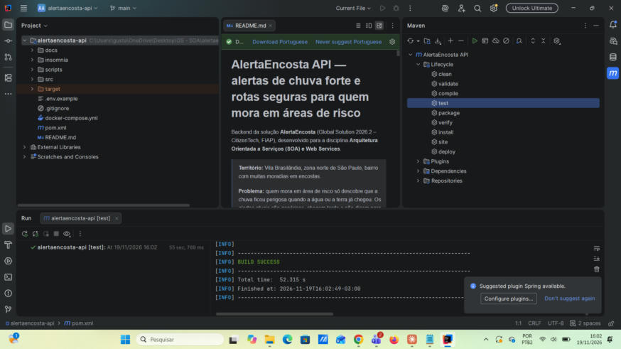

Resumo da execução: 7 testes em `AlertaEncostaApiIntegrationTest` (sobe a aplicação inteira com H2, aplica as migrações e valida o fluxo leitura → alerta → pendências) e 9 em `DominioAlertaEncostaTest` (regras de negócio). **16 testes, 0 falhas.**

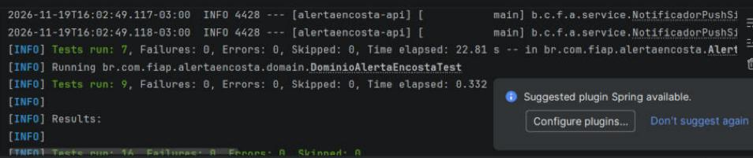

## 2. Aplicação subindo (`spring-boot:run`)

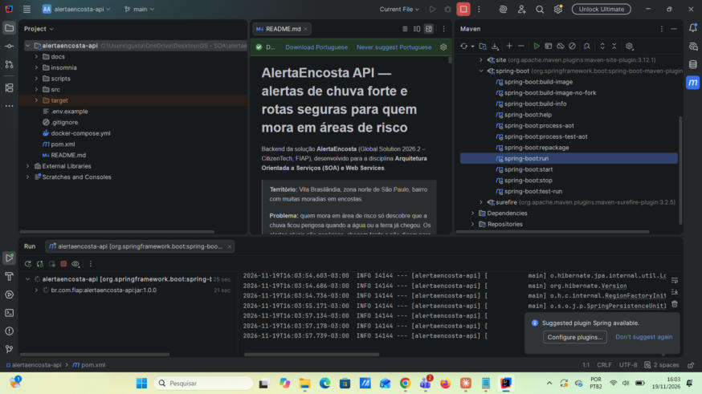

## 3. Documentação OpenAPI / Swagger UI

http://localhost:8080/swagger-ui.html

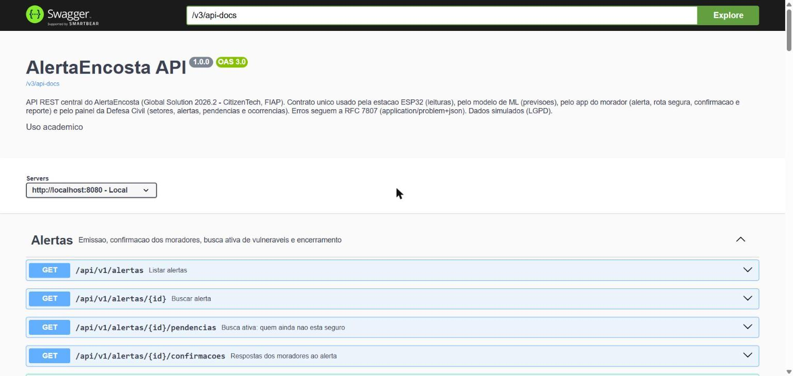

## 4. Fluxo principal: leitura do ESP32 eleva o risco e escala o alerta

`POST /api/v1/estacoes/1/leituras` com `{"chuvaMm": 92.0, "umidadeSoloPct": 90.0}` pelo Swagger → **201 Created**. A regra de limites classificou o setor BR-01 de **BAIXO para ALTO**.

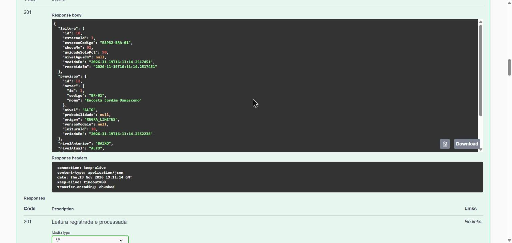

O alerta manual MÉDIO que existia no BR-01 foi **escalado automaticamente para ALTO**, com a mensagem refeita, o ponto de apoio mais próximo, a distância, o tempo a pé e o link do mapa (`GET /api/v1/alertas?status=ATIVO&setorId=1`):

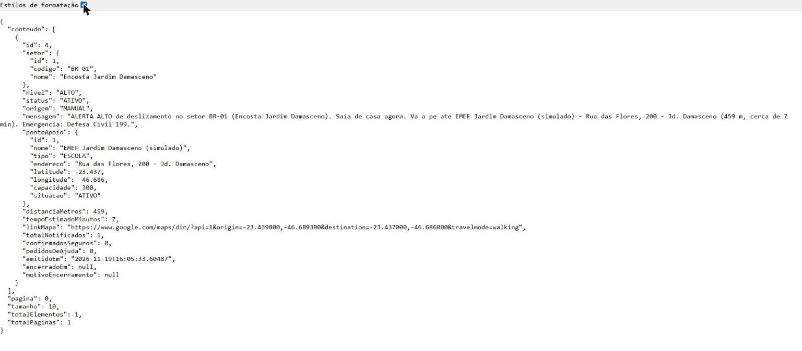

## 5. Busca ativa de vulneráveis

`GET /api/v1/alertas/1/pendencias`: primeiro quem pediu ajuda (Maria, idosa), depois prioritários sem resposta (Antonia, mobilidade reduzida).

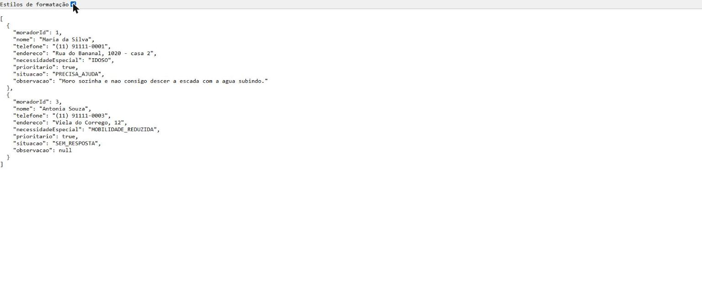

## 6. Situação do setor (painel da Defesa Civil)

`GET /api/v1/setores/2/situacao`: nível ALTO, última leitura do ESP32-BRA-02, alerta ativo, 3 moradores (2 prioritários).

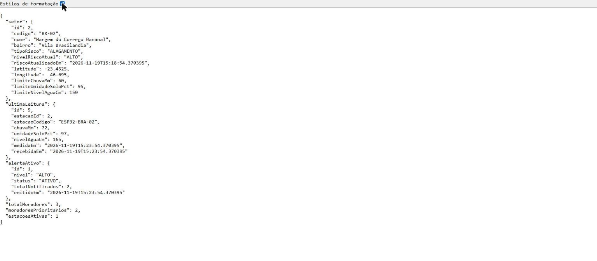

## 7. Rota segura do morador

`GET /api/v1/moradores/1/rota-segura`: ponto de apoio ATIVO mais próximo, 484 m, ~7 min a pé, com link do Google Maps.

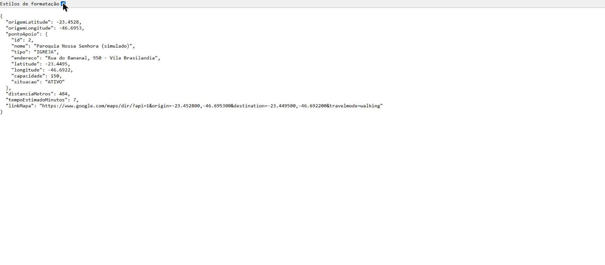

## 8. Indicadores de impacto

`GET /api/v1/indicadores`

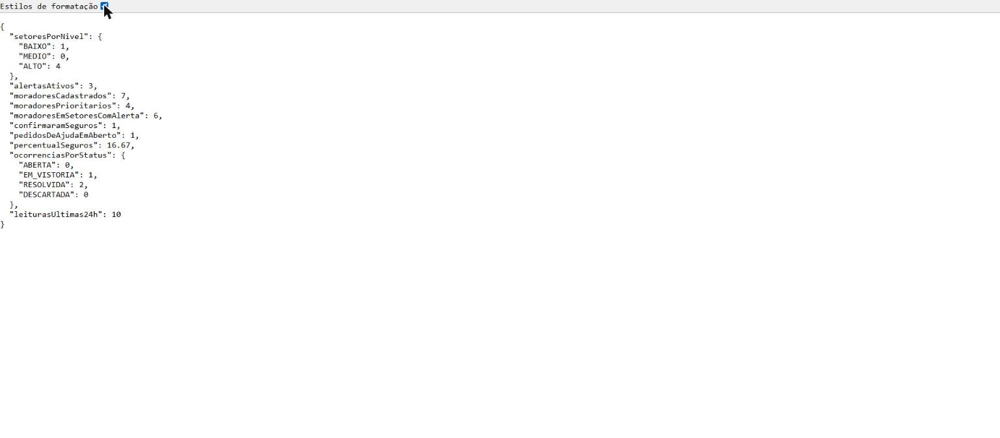

## 9. Tratamento de erros (RFC 7807 — Problem Details)

`GET /api/v1/setores/9999` → **404** no formato Problem Details. Os cenários 400, 409 e 422 estão no relatório dos testes manuais.

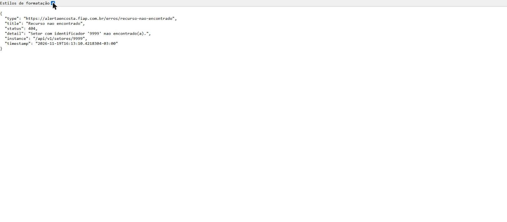

## 10. Banco de dados e migrações

Console H2 (`/h2-console`, JDBC `jdbc:h2:file:./data/alertaencosta`): as 10 tabelas `TB_AE_*` e o histórico do Flyway com as migrações **V1 a V5 aplicadas com sucesso**.

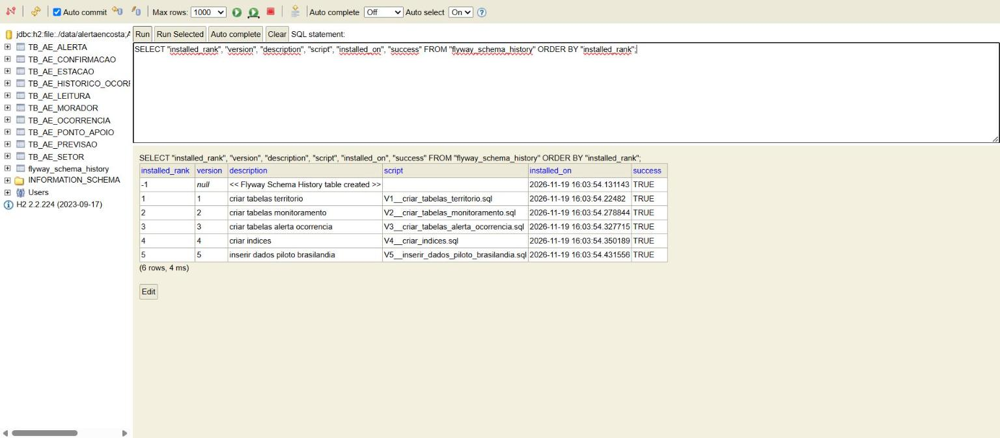

Alertas gravados no banco: o automático do BR-02 (carga inicial), o do BR-05 (gerado pela leitura e depois encerrado), o do BR-03 (gerado pela previsão do modelo de ML) e o manual do BR-01 (escalado para ALTO).

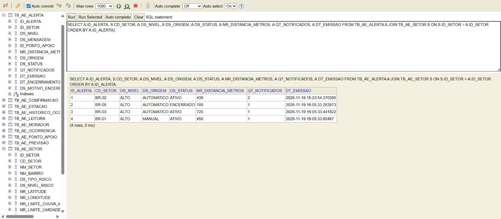

---

## Como reproduzir

1. `mvn test`
2. Apague a pasta `data/` (banco limpo) e rode `mvn spring-boot:run`.
3. Importe `insomnia/alertaencosta-insomnia.json` no Insomnia e execute as requisições 01 → 70 em ordem. Ou rode `bash scripts/testes-manuais.sh`, que regrava `execucao-testes-manuais.md`.
